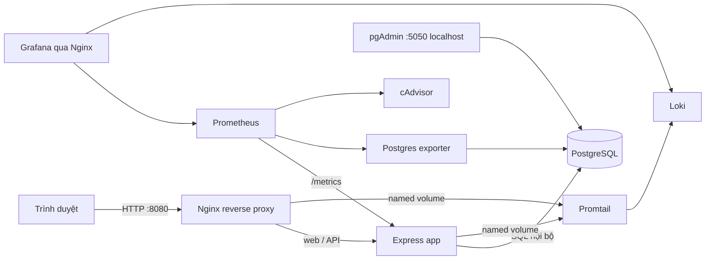
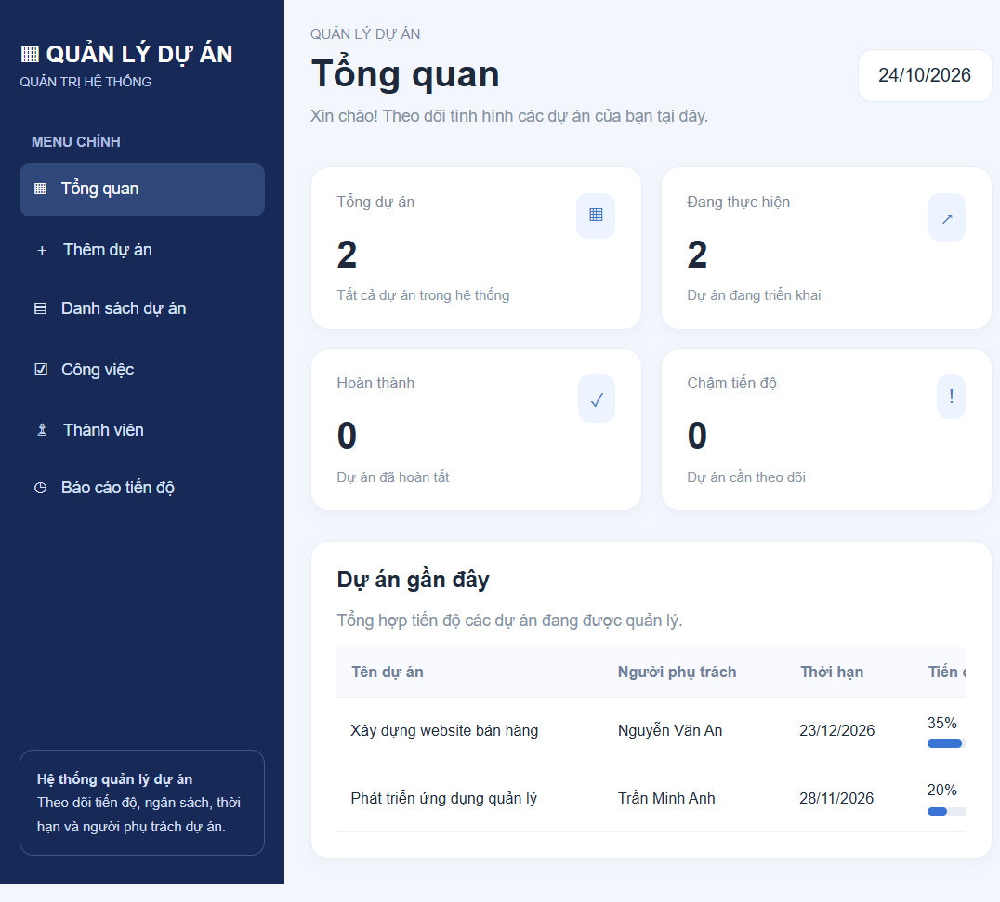
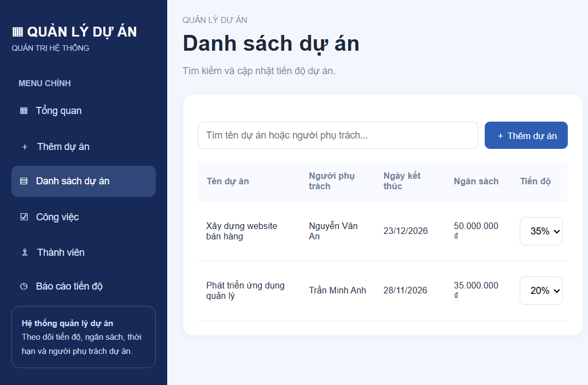
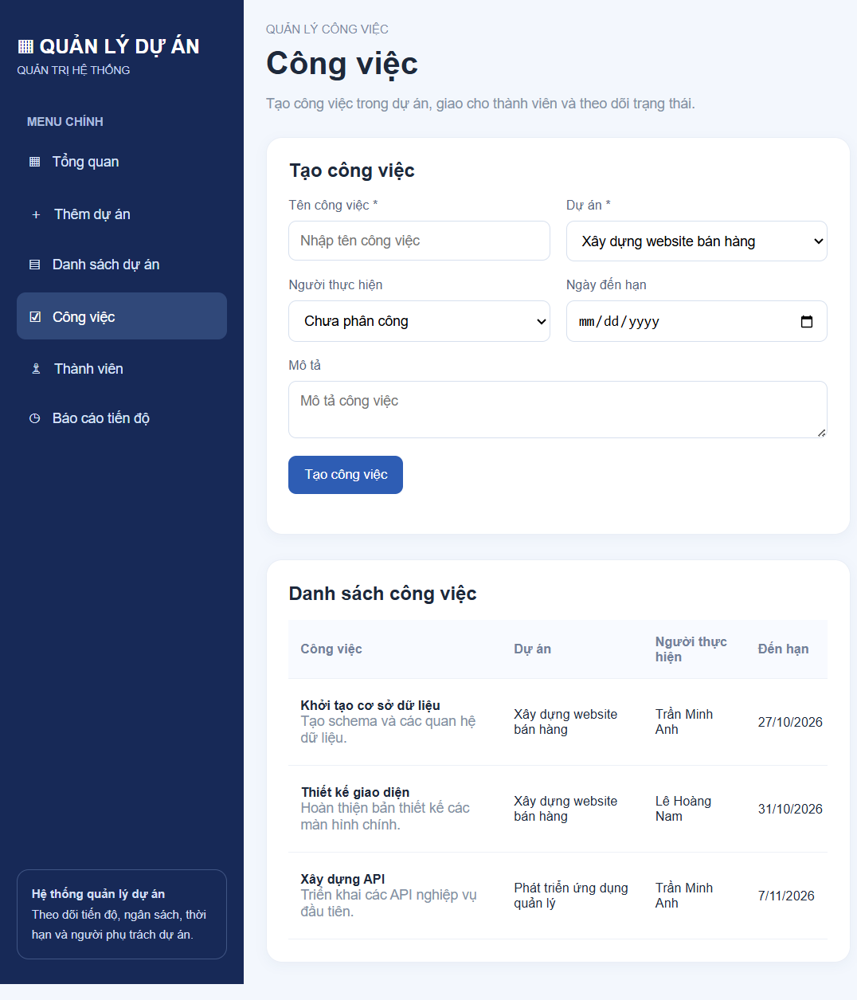
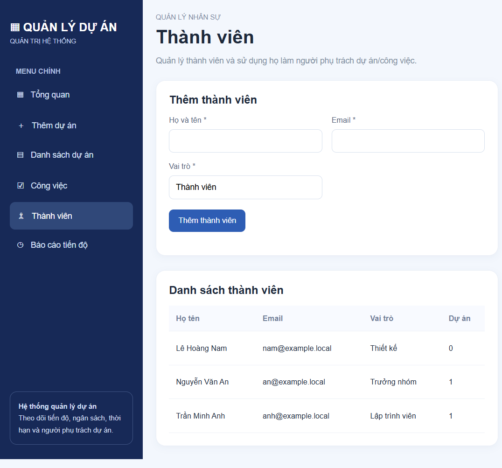

# BÁO CÁO ĐỒ ÁN

## HỆ THỐNG QUẢN LÝ DỰ ÁN

**Đề tài 14 — Project Management**

| Thông tin | Nội dung |
|---|---|
| Sinh viên | Nguyễn Đan Trường |
| Mã sinh viên | DTC245200092 |
| Lớp | ........................................................ |
| Giảng viên hướng dẫn | ........................................................ |
| Trường/Khoa | ........................................................ |
| Năm học | 2026–2027 |

**Báo cáo triển khai ứng dụng quản lý dự án, thành viên, công việc và nền tảng giám sát/log tập trung bằng Docker Compose.**

> Trước khi nộp: bổ sung lớp, giảng viên, trường/khoa; chèn ảnh chụp màn hình thực tế vào các vị trí minh chứng; xuất PDF và kiểm tra số trang sau khi định dạng theo mẫu của trường.

<div style="page-break-after: always;"></div>

# 1. Tóm tắt và mục tiêu

Đề tài xây dựng một hệ thống quản lý dự án chạy trên nền tảng container. Ứng dụng cho phép người dùng tạo dự án, quản lý thành viên, chia dự án thành công việc, giao việc và theo dõi tiến độ. Dữ liệu nghiệp vụ được lưu bền vững trong PostgreSQL thay vì biến trong bộ nhớ. pgAdmin cung cấp giao diện quản trị cơ sở dữ liệu. Nginx làm reverse proxy và áp dụng các security headers cơ bản. Prometheus thu thập metrics; Grafana hiển thị nguồn metrics và log; Loki lưu log; Promtail chuyển log ứng dụng và reverse proxy về Loki.

Mục tiêu kỹ thuật:

1. Đóng gói, cấu hình và chạy toàn bộ dịch vụ bằng Docker Compose.
2. Thiết kế quan hệ dữ liệu giữa thành viên, dự án và công việc; tích hợp quản trị database bằng pgAdmin.
3. Đưa các request web qua Nginx, bổ sung header an toàn và giới hạn tốc độ API.
4. Theo dõi trạng thái ứng dụng, PostgreSQL và container bằng Prometheus/Grafana.
5. Tập trung log bằng Loki/Promtail và chứng minh khả năng truy vấn LogQL.
6. Áp dụng network isolation, non-root cho app/proxy, filesystem chỉ đọc và quản lý mật khẩu qua file môi trường cục bộ.

## Phạm vi

Đây là bản demo quản lý nội bộ, chưa triển khai đăng nhập, phân quyền người dùng, thông báo, đính kèm tài liệu hoặc sao lưu tự động. Các endpoint nghiệp vụ hiện không yêu cầu xác thực; chỉ chạy trong môi trường demo tin cậy, không đưa trực tiếp ra Internet. Mật khẩu trong `.env` phải được thay riêng trên từng máy và không commit lên repository.

## Kết quả mong đợi

Người dùng thao tác trên một giao diện thống nhất; các lựa chọn phân công lấy trực tiếp từ danh sách thành viên, công việc bắt buộc thuộc về một dự án, và thay đổi trạng thái công việc làm cập nhật tiến độ tổng hợp của dự án. Dữ liệu vẫn tồn tại sau khi container được tạo lại nhờ named volumes.

<div style="page-break-after: always;"></div>

# 2. Yêu cầu và kiến trúc tổng thể

Hệ thống triển khai các dịch vụ độc lập: `app`, `db`, `pgadmin`, `nginx`, `prometheus`, `postgres-exporter`, `cadvisor`, `grafana`, `loki` và `promtail`. Docker Compose quản lý thứ tự khởi động, healthcheck, mạng riêng và lưu trữ lâu dài.



Mạng được tách thành ba vùng:

- **proxy**: Nginx, app, Grafana và Prometheus để proxy chuyển tiếp yêu cầu.
- **backend** (internal): app, PostgreSQL, pgAdmin và exporter; không publish PostgreSQL ra host.
- **observability** (internal): Prometheus, exporter, cAdvisor, Grafana, Loki và Promtail.

Nginx là điểm vào cho web, API, metrics, healthcheck, Prometheus và Grafana. pgAdmin chỉ bind địa chỉ loopback của máy host. Không cần cấp Docker socket cho Promtail: log app và Nginx được chia sẻ qua named volume chỉ đọc ở phía Promtail.

**Minh chứng cần chèn:** ảnh sơ đồ kiến trúc do sinh viên vẽ lại hoặc ảnh sơ đồ trên; ảnh `docker compose ps` cho thấy các dịch vụ đã chạy.



<div style="page-break-after: always;"></div>

# 3. Thiết kế dữ liệu và quan hệ nghiệp vụ

PostgreSQL lưu ba bảng nghiệp vụ. Schema được khởi tạo khi ứng dụng bắt đầu; lần khởi tạo đầu tạo dữ liệu mẫu để có thể trình diễn ngay. Dữ liệu không được dựng lại nếu bảng thành viên đã có dữ liệu. Connection pool của thư viện `pg` được cấu hình qua biến môi trường.

## Bảng dữ liệu

| Bảng | Trường chính | Mục đích |
|---|---|---|
| `members` | `id`, `name`, `email`, `role`, `created_at` | Thành viên và vai trò; email duy nhất |
| `projects` | `id`, `name`, `start_date`, `end_date`, `budget`, `progress`, `status`, `owner_id` | Dự án và người phụ trách tùy chọn |
| `tasks` | `id`, `project_id`, `assignee_id`, `title`, `description`, `due_date`, `status`, `progress` | Công việc thuộc dự án, tùy chọn người thực hiện |

`projects.owner_id` tham chiếu `members.id` với `ON DELETE SET NULL`. `tasks.project_id` tham chiếu `projects.id` với `ON DELETE CASCADE`; xóa dự án xóa công việc liên quan. `tasks.assignee_id` cũng dùng `ON DELETE SET NULL`, nên xóa thành viên không xóa công việc. CHECK constraints giới hạn ngân sách không âm, tiến độ trong khoảng 0–100, trạng thái công việc hợp lệ và ngày kết thúc không trước ngày bắt đầu. Index trên `tasks.project_id` và `tasks.assignee_id` hỗ trợ truy vấn liên kết.

Khi tạo, cập nhật trạng thái hoặc xóa công việc, ứng dụng tính trung bình `progress` của các công việc trong dự án rồi đồng bộ `projects.progress`; khi không còn công việc, tiến độ dự án trở về 0. Các thao tác công việc và cập nhật tiến độ dự án nằm trong cùng giao dịch. Trạng thái dự án chuyển sang hoàn thành khi trung bình đạt 100%.

**Minh chứng cần chèn:** ảnh pgAdmin hiển thị ba bảng, quan hệ khóa ngoại và dữ liệu mẫu; che email/thông tin cá nhân nếu dùng dữ liệu thật.

<div style="page-break-after: always;"></div>

# 4. Ứng dụng và luồng chức năng

Giao diện Dashboard được phục vụ bởi Express và sử dụng cùng bộ API REST với dữ liệu PostgreSQL. Từng màn hình làm mới dữ liệu từ API sau thao tác để số liệu tổng quan, danh sách dự án, công việc, thành viên và báo cáo không bị tách rời.

## Luồng quản lý

1. **Thành viên:** nhập tên, email hợp lệ và vai trò. Email trùng được database từ chối; API phản hồi lỗi xung đột. Xóa thành viên sẽ bỏ phân công khỏi dự án/công việc nhưng giữ nguyên các bản ghi.
2. **Dự án:** nhập tên, thời gian, ngân sách và chọn một thành viên từ danh sách. Người phụ trách được lưu thành khóa ngoại, không lưu chuỗi tên rời rạc. Có thể tìm, cập nhật tiến độ thủ công hoặc xóa dự án.
3. **Công việc:** nhập tên, chọn dự án bắt buộc, tùy chọn thành viên, ngày đến hạn và mô tả. Trạng thái có ba giá trị: mới, đang thực hiện, hoàn thành. Thay đổi trạng thái hoặc xóa việc sẽ cập nhật tiến độ tổng hợp của dự án.
4. **Báo cáo:** dashboard hiển thị số dự án theo trạng thái; trang báo cáo tổng ngân sách và tiến độ trung bình. Các trang dùng cùng bộ dữ liệu API.

API chính: `GET/POST /api/projects`, `PATCH/DELETE /api/projects/:id`, `GET/POST/DELETE /api/members`, `GET/POST /api/tasks`, `PATCH/DELETE /api/tasks/:id`. API xác thực dữ liệu đầu vào, dùng truy vấn SQL có tham số để chống ghép dữ liệu vào câu lệnh SQL và trả lỗi JSON phù hợp.

Ứng dụng ghi log có thời gian, HTTP method và path; không ghi body chứa dữ liệu người dùng. `/health` kiểm tra cả kết nối PostgreSQL; `/metrics` xuất chỉ số mặc định của Node.js cho Prometheus.

**Minh chứng cần chèn:** dashboard; form tạo thành viên; thành viên được chọn làm chủ dự án; công việc có dự án và người thực hiện; ảnh trạng thái dự án trước/sau khi đánh dấu công việc hoàn thành.







<div style="page-break-after: always;"></div>

# 5. Docker Compose, PostgreSQL và pgAdmin

Compose khởi động PostgreSQL trước ứng dụng. Healthcheck `pg_isready` giúp app chỉ bắt đầu sau khi database sẵn sàng. App tạo schema và seed dữ liệu bằng kết nối nội bộ; cấu hình không chứa mật khẩu cố định trong source code. Mật khẩu được truyền từ `.env` không commit. Named volume `postgres_data` giữ dữ liệu ngoài vòng đời container.

pgAdmin truy cập qua `http://localhost:5050`; đăng nhập bằng giá trị `PGADMIN_EMAIL`/`PGADMIN_PASSWORD` trong `.env`. Tạo server kết nối với hostname Docker `db`, port 5432, database `project_management`, user `project_app`. Từ máy host, không thể kết nối trực tiếp tới cổng PostgreSQL vì cổng này không publish. Cổng pgAdmin chỉ lắng nghe `127.0.0.1`.

Các lệnh triển khai:

```powershell
Copy-Item .env.example .env
# Thay mật khẩu mẫu trong .env bằng các mật khẩu riêng, ngẫu nhiên.
docker compose config
docker compose up --build -d
docker compose ps
docker compose logs -f app
```

`docker compose down` dừng và xóa container nhưng giữ named volume. `docker compose down -v` xóa cả volume, do đó xóa dữ liệu database và dữ liệu giám sát; chỉ dùng khi chủ động muốn dựng lại từ đầu. Khi nộp bài, kiểm tra `.env` không nằm trong Git và repository có `.env.example` không chứa bí mật.

**Minh chứng cần chèn:** cấu hình server pgAdmin đã kết nối; bảng projects/members/tasks có dữ liệu; `docker compose ps`; chỉ hiển thị nội dung đã được che mật khẩu.

<div style="page-break-after: always;"></div>

# 6. Nginx reverse proxy và hardening

Nginx unprivileged lắng nghe cổng 8080 trong container và publish cổng 8080 trên host. `/` và `/api/` được chuyển tới Express; `/metrics` và `/health` chuyển tới endpoint tương ứng; `/prometheus/` và `/grafana/` chuyển tới công cụ quan sát. Nginx ghi access/error log vào volume để Promtail đọc. Init container một lần đặt quyền ghi cho user Nginx không-root; Promtail mount volume ở chế độ chỉ đọc.

Các header phản hồi gồm `X-Content-Type-Options: nosniff`, `X-Frame-Options: DENY`, `Referrer-Policy` và `Permissions-Policy`. `server_tokens off` ẩn phiên bản Nginx; request tới đường dẫn dotfile bị từ chối; API có giới hạn 10 request/giây với burst ngắn. Kích thước request body được giới hạn 1 MB.

Biện pháp hardening bổ sung:

- App chạy bằng user `node`; app và Nginx bỏ Linux capabilities, bật `no-new-privileges`.
- Filesystem container app/Nginx đặt read-only; chỉ cấp tmpfs/volume cần thiết để chạy và ghi log.
- PostgreSQL không publish port; backend/observability là các Docker network internal.
- pgAdmin bind localhost; mật khẩu database, Grafana, pgAdmin cấu hình qua `.env`.
- Promtail chỉ đọc volume log; không mount Docker socket.
- API dùng parameterized SQL, ràng buộc dữ liệu ở tầng ứng dụng và database.

HTTPS chưa được cấu hình; môi trường demo hiện sử dụng HTTP trên localhost. Khi triển khai thật cần chứng thư TLS, xác thực người dùng, quản lý secrets chuyên dụng, backup/restore và giới hạn truy cập mạng phù hợp.

**Minh chứng cần chèn:** kiểm tra response headers bằng DevTools hoặc `curl -I http://localhost:8080/`; ảnh cấu hình Nginx; xác nhận Docker Compose không publish cổng database.

<div style="page-break-after: always;"></div>

# 7. Prometheus và Grafana

Prometheus scrape định kỳ bốn nhóm mục tiêu: chính Prometheus, ứng dụng Node.js, postgres-exporter và cAdvisor. postgres-exporter đọc thống kê database bằng tài khoản ứng dụng trên mạng backend; cAdvisor cung cấp chỉ số container cho Prometheus. Grafana được provision sẵn datasource Prometheus và Loki, không cần khai báo thủ công sau lần khởi chạy đầu.

Các truy vấn PromQL dùng khi demo:

```promql
up
rate(container_cpu_usage_seconds_total[5m])
pg_up
```

`up` kiểm tra trạng thái scrape theo job; `rate(...)` quan sát mức sử dụng CPU container theo thời gian; `pg_up` kiểm tra kết nối/exporter PostgreSQL. Có thể lọc theo `job` hoặc `instance` và chọn khoảng thời gian trên giao diện Grafana/Prometheus. Nếu một target đang DOWN, kiểm tra `docker compose ps`, log exporter và mạng Compose trước khi kết luận ứng dụng lỗi.

Phạm vi hiện tại cung cấp datasource và metrics để sinh viên xây dashboard khi trình diễn. Các panel tùy biến, cảnh báo email/Slack và lưu trữ metrics dài hạn chưa nằm trong phạm vi.

**Minh chứng cần chèn:** trang Prometheus Targets với các job; Grafana Explore chạy `up`; đồ thị CPU container; chỉ số `pg_up`. Chụp ảnh thấy URL/nhãn metric nhưng không lộ mật khẩu.

<div style="page-break-after: always;"></div>

# 8. Loki, Promtail và truy vấn LogQL

Ứng dụng ghi log dạng một dòng có timestamp và thông tin request (method/path) ra stdout và file `app.log`. Promtail đọc log ứng dụng và log Nginx từ hai volume chỉ đọc, gắn nhãn `job=app` hoặc `job=nginx` rồi gửi batch log đến endpoint Loki nội bộ. Loki lưu chunk/index bằng filesystem và tắt anonymous analytics.

Ba truy vấn LogQL để thực hành:

```logql
{job="app"}
{job="nginx"} |= "POST"
{job="app"} |= "Database"
```

Truy vấn đầu liệt kê log ứng dụng; truy vấn thứ hai lọc request POST trên proxy; truy vấn thứ ba tìm các dòng liên quan tới database. Chọn time range bao gồm thời điểm phát sinh request. Có thể tạo log mới bằng cách tải lại trang hoặc tạo một bản ghi, đợi Promtail scrape rồi chạy lại query. Log hiện tại không bao gồm request body hay mật khẩu.

Quy trình kiểm tra lỗi: kiểm tra container Promtail/Loki ở trạng thái chạy; xem `docker compose logs promtail loki`; xác nhận volume log có file; kiểm tra datasource Loki trong Grafana; mở rộng khoảng thời gian nếu log mới chưa nằm trong time range.

**Minh chứng cần chèn:** Grafana Explore chọn datasource Loki và kết quả ít nhất hai truy vấn LogQL; log ứng dụng có request tạo/cập nhật dữ liệu; log Nginx tương ứng.

<div style="page-break-after: always;"></div>

# 9. Kiểm thử nghiệm thu và kết quả

Thực hiện các bước dưới đây sau khi khởi động trên máy trình diễn. Điền kết quả quan sát được vào cột cuối và đính kèm ảnh/chụp màn hình. Không ghi “thành công” nếu chưa chạy thực tế.

| STT | Kịch bản | Kết quả cần xác nhận | Kết quả thực tế |
|---|---|---|---|
| 1 | `docker compose config` | Compose hợp lệ | Đạt; lệnh trả mã 0 |
| 2 | `docker compose ps` | Các dịch vụ không restart liên tục | Đạt; app healthy, DB/cAdvisor healthy, các dịch vụ còn lại Up |
| 3 | Mở `/health` | HTTP 200, `database: ok` | Đạt; `status=ok`, `database=ok` |
| 4 | Thêm thành viên có email mới | Thành viên xuất hiện ở danh sách/lựa chọn | Đạt qua API; bản ghi thử nghiệm đã được xóa sau kiểm thử |
| 5 | Tạo dự án và chọn người phụ trách | Dự án hiển thị đúng tên thành viên | Đạt qua API; quan hệ thành viên được trả về trong danh sách |
| 6 | Tạo task gắn với dự án/thành viên | Danh sách thể hiện đúng hai liên kết | Đạt qua API; task trả về đúng `projectId` và `memberId` |
| 7 | Đổi task thành hoàn thành | Tiến độ dự án được tính lại | Đạt; dự án chuyển tới 100%/“Hoàn thành” |
| 8 | Xóa task/project hoặc thành viên | Các quan hệ tuân theo chính sách đã mô tả | Đạt; xóa task cuối cùng đưa tiến độ về 0; dữ liệu thử được dọn |
| 9 | Khởi động lại app/Compose | Dữ liệu nghiệp vụ còn trong PostgreSQL | Đạt sau khi restart app; PostgreSQL health vẫn OK và hai dự án còn nguyên |
| 10 | Prometheus/Grafana/Loki | Target và tối thiểu hai LogQL query chạy được | Đạt; 4 targets up, 2 datasource provisioned; truy vấn app có 2 streams và Nginx POST có 1 stream |
| 11 | Kiểm tra hardening | Header có mặt, DB không publish port | Đạt; headers được trả về, app chạy `node`/read-only/cap drop ALL; pgAdmin chỉ bind localhost |

Các phép thử API bổ sung: gửi thiếu tên dự án/email sai/tiến độ ngoài khoảng 0–100 phải nhận phản hồi lỗi; email trùng phải bị từ chối; SQL injection qua trường text không được thực thi vì dữ liệu được truyền bằng tham số. Không thực hiện kiểm thử xâm nhập lên hệ thống ngoài phạm vi đồ án.

**Minh chứng cần chèn:** ảnh kết quả từng nhóm kiểm thử; ẩn địa chỉ email cá nhân, token, mật khẩu hoặc thông tin nhạy cảm trước khi nộp.

<div style="page-break-after: always;"></div>

# 10. Hướng dẫn demo, hạn chế và kết luận

## Kịch bản demo đề xuất

1. Chạy `docker compose ps`, mở dashboard tại `http://localhost:8080`.
2. Mở trang thành viên và tạo một thành viên demo.
3. Tạo dự án mới, chọn thành viên vừa tạo làm phụ trách.
4. Sang trang công việc, tạo hai công việc cùng dự án; giao một việc cho thành viên.
5. Đánh dấu một công việc hoàn thành; quay lại dashboard/báo cáo để trình bày tiến độ được đồng bộ.
6. Mở pgAdmin và chỉ ra khóa ngoại/dữ liệu đã lưu.
7. Mở Grafana Explore: chạy `up`, sau đó chọn Loki và chạy hai truy vấn LogQL.
8. Giải thích các lớp hardening; không mở trực tiếp PostgreSQL ra host.

## Hạn chế và hướng phát triển

Ứng dụng chưa có login/role-based access control, chỉnh sửa chi tiết thành viên, thông báo, audit log, phân quyền project, sao lưu tự động, TLS và dashboard/cảnh báo được thiết kế sẵn. Mật khẩu `.env` là cấu hình cục bộ, không thay thế secret manager. cAdvisor cần quyền đọc một số thông tin host để thu thập metrics; cần đánh giá lại quyền và cấu hình riêng nếu chuyển sang môi trường production. Trạng thái “chậm tiến độ” chưa được tính tự động theo lịch; cần đặc tả quy tắc nghiệp vụ trước khi bổ sung.

## Kết luận

Đồ án kết nối ứng dụng Express với PostgreSQL và pgAdmin, đưa các màn hình dự án–thành viên–công việc vào một luồng dữ liệu thống nhất, đồng thời triển khai proxy, metrics và log tập trung bằng Docker Compose. Các module nghiệp vụ có khóa ngoại và chính sách xóa rõ ràng; thay đổi công việc ảnh hưởng trực tiếp tới tiến độ dự án. Những biện pháp hardening cơ bản đã được áp dụng, nhưng sản phẩm vẫn là bản demo nội bộ và cần xác thực, HTTPS, backup, kiểm thử tải và quản lý secret trước khi triển khai công khai.

## Tài liệu tham khảo

- Docker Compose documentation: https://docs.docker.com/compose/
- PostgreSQL documentation: https://www.postgresql.org/docs/
- Express documentation: https://expressjs.com/
- Nginx documentation: https://nginx.org/en/docs/
- Prometheus documentation: https://prometheus.io/docs/
- Grafana, Loki và LogQL documentation: https://grafana.com/docs/

**Ghi chú nộp bài:** hoàn thiện thông tin bìa và bảng kết quả kiểm thử; chèn ảnh minh chứng thực tế; xuất báo cáo ít nhất 10 trang theo mẫu trình bày của trường; tải mã nguồn và README lên repository GitHub theo mã sinh viên.
